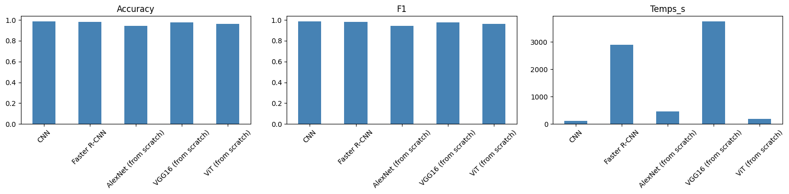
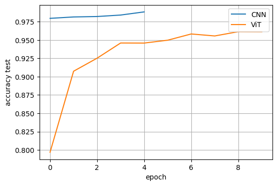

# Lab 2 – Deep Learning avec PyTorch (MNIST)

**Université Abdelmalek Essaâdi – FST Tanger – Département Génie Informatique**
**Module :** Deep Learning – Pr. EL AACHAK Lotfi
**Étudiante :** AATAR KARIMA
**Master :** Sécurité IT & Big DATA

Ce dépôt contient le travail du Lab 2 : classification de MNIST avec un CNN, Faster R-CNN, VGG16 / AlexNet et un Vision Transformer (ViT) implémenté from scratch.

## Contenu du dépôt

| Fichier | Description |
|---|---|
| `Lab2_DeepLearning.ipynb` | Notebook complet avec le code et les résultats de chaque cellule |
| `images/` | Figures générées (comparaison des modèles, courbes d'accuracy) |
| `requirements.txt` | Dépendances Python |

## Environnement d'exécution

- Plateforme : Kaggle (notebook), Python 3.13, PyTorch / torchvision
- **Device utilisé : CPU** (le notebook détecte automatiquement le GPU via `torch.device("cuda" if torch.cuda.is_available() else "cpu")` ; le même code s'exécute en mode GPU si un accélérateur est activé). Les temps d'entraînement ci-dessous correspondent donc à une exécution CPU.
- Données : MNIST, **20 000 images d'entraînement** et 10 000 de test (fichiers CSV `mnist_train_small.csv` / `mnist_test.csv`), pixels normalisés dans [0, 1].
- Graine aléatoire fixée (`torch.manual_seed(42)`).

---

## Partie 1 – Classifieurs CNN

### Q1 – CNN (PyTorch)

Architecture :

| Couche | Détails |
|---|---|
| Conv2d(1→32) + BatchNorm + ReLU + MaxPool(2) | kernel 3×3, stride 1, padding 1 (28→14) |
| Conv2d(32→64) + BatchNorm + ReLU + MaxPool(2) | kernel 3×3, stride 1, padding 1 (14→7) |
| Conv2d(64→128) + BatchNorm + ReLU + MaxPool(2) | kernel 3×3, stride 1, padding 1 (7→3) |
| Flatten → Linear(1152→128) + ReLU + Dropout(0.5) → Linear(128→10) | couches fully connected |

- Optimiseur : **Adam**, lr = 1e-3, **weight decay = 1e-4** (régularisation L2) + **Dropout 0,5** + BatchNorm
- Perte : cross-entropy ; batch size 128 ; 5 époques
- Environ **242 000 paramètres**

Résultat : accuracy **98,83 %**, F1 macro **0,9882**, loss de test **0,0357**, temps **120 s**.

### Q2 – Faster R-CNN

Faster R-CNN est un modèle de **détection**. MNIST a été converti en problème de détection :
- boîte englobante = zone des pixels non nuls (> 0,1) ;
- label = chiffre + 1 (la classe 0 est réservée au fond) ;
- prédiction de classification = label de la détection ayant le **score le plus élevé**.

Configuration : `fasterrcnn_mobilenet_v3_large_fpn` (sans poids pré-entraînés, 11 classes), images redimensionnées à 128 px, SGD (lr = 0,01, momentum = 0,9, weight decay = 5e-4), 4 époques, **sous-ensemble de 6 000 images d'entraînement** et 1 000 de test pour limiter le temps de calcul.

Résultat : accuracy **98,10 %**, F1 macro **0,9806**, loss d'entraînement **0,6265**, temps **2 905 s**.

> La loss de Faster R-CNN est la somme des pertes RPN + classification + régression de boîtes. Elle n'est **pas directement comparable** à la cross-entropy des classifieurs.

### Q3 – Comparaison CNN vs Faster R-CNN

| Modèle | Accuracy | F1 macro | Loss | Temps (s) |
|---|---|---|---|---|
| CNN | **0,9883** | **0,9882** | **0,0357** | **120** |
| Faster R-CNN | 0,9810 | 0,9806 | 0,6265 (non comparable) | 2905 |

Le CNN est plus précis et environ **24 fois plus rapide**. Faster R-CNN est conçu pour localiser et classer plusieurs objets (RPN, RoI pooling, deux têtes) : pour des chiffres centrés et isolés, cette complexité n'apporte rien et augmente fortement le coût de calcul. Il est de plus entraîné sur moins de données (6 000 images) que le CNN (20 000).

### Q4 – VGG16 et AlexNet

Pré-traitement : image 28×28 → 3 canaux → redimensionnement 64×64 → normalisation ImageNet. Sous-ensemble de 10 000 images, 3 époques, Adam, batch size 64, dernière couche remplacée (4096 → 10).

> **Limite importante :** le code essaie de charger les poids ImageNet pour faire du *fine-tuning* (couches convolutives gelées). Dans mon exécution Kaggle, **Internet était désactivé** (la vérification téléphone du compte n'a pas pu être finalisée), donc les poids n'ont pas pu être téléchargés. **Les deux modèles ont été entraînés from scratch**, avec la même architecture mais sans transfer learning. Les résultats ci-dessous ne permettent donc pas d'évaluer l'apport du pré-entraînement. Relancer le notebook avec Internet activé (par ex. sur Google Colab) exécute le vrai fine-tuning sans modifier le code.

| Modèle | Paramètres | Accuracy | F1 macro | Loss | Temps (s) |
|---|---|---|---|---|---|
| AlexNet (from scratch) | ≈ 57 M | 0,9444 | 0,9440 | 0,2431 | 456 |
| VGG16 (from scratch) | ≈ 134 M | 0,9792 | 0,9793 | 0,0680 | 3760 |

### Tableau comparatif global (Partie 1 + ViT)

| Modèle | Accuracy | F1 macro | Loss | Temps (s) |
|---|---|---|---|---|
| CNN | **0,9883** | **0,9882** | **0,0357** | **120** |
| Faster R-CNN | 0,9810 | 0,9806 | 0,6265* | 2905 |
| AlexNet (from scratch) | 0,9444 | 0,9440 | 0,2431 | 456 |
| VGG16 (from scratch) | 0,9792 | 0,9793 | 0,0680 | 3760 |
| ViT (from scratch) | 0,9612 | 0,9609 | 0,1330 | 178 |

\* somme de pertes de détection, non comparable.



### Conclusion de la Partie 1

- Le **CNN** est le meilleur compromis précision / coût : 98,8 % en 2 minutes avec seulement ~242 k paramètres.
- **VGG16** atteint 97,9 % mais coûte plus de 30 fois le temps du CNN pour une précision inférieure : il est très surdimensionné pour MNIST.
- **AlexNet** progresse plus lentement (94,4 % après 3 époques) ; il aurait besoin de plus d'époques ou de poids pré-entraînés.
- Sur une tâche aussi simple que MNIST (petites images centrées, une seule classe par image), augmenter la taille ou la complexité du modèle n'améliore pas le résultat.

---

## Partie 2 – Vision Transformer (ViT) from scratch

Implémentation suivant les étapes du tutoriel :

1. **Patch embedding** : image 28×28 découpée en patchs 7×7 → 16 patchs, projetés en dimension 64 (via une convolution de kernel = stride = 7, équivalente à un découpage + couche linéaire)
2. **Token [CLS]** appris, ajouté en tête de séquence (17 tokens au total)
3. **Encodage positionnel** appris
4. **4 blocs Transformer** : LayerNorm → Multi-Head Self-Attention (4 têtes, implémentée à la main) → connexion résiduelle → LayerNorm → MLP (GELU, ratio 4, dropout 0,1) → connexion résiduelle
5. **Tête de classification** : LayerNorm + Linear(64→10) appliquée au token [CLS]

Entraînement : Adam (lr = 1e-3, weight decay = 1e-4), batch size 128, **10 époques**, ~**205 000 paramètres**.

| Époque | 1 | 2 | 4 | 6 | 8 | 10 |
|---|---|---|---|---|---|---|
| Accuracy test | 0,797 | 0,907 | 0,946 | 0,950 | 0,956 | 0,961 |

Résultat final : accuracy **96,12 %**, F1 macro **0,9609**, loss de test **0,1330**, temps **178 s**.



### Interprétation et comparaison avec la Partie 1

- Le ViT atteint **96,1 %**, soit ~2,7 points de moins que le CNN (98,8 %), avec un nombre de paramètres comparable (205 k contre 242 k) et un temps d'entraînement proche (178 s pour 10 époques contre 120 s pour 5 époques du CNN).
- Le CNN dépasse 97,9 % dès la 1ʳᵉ époque, alors que le ViT en demande plus de 10 pour atteindre 96 %. Le CNN intègre des **biais inductifs** adaptés aux images (localité, partage de poids, invariance par translation). Le ViT doit **apprendre ces structures spatiales à partir des données**, ce qui demande plus de données et d'époques.
- La courbe d'accuracy du ViT progresse encore à la dixième époque : un entraînement plus long, des patchs plus petits (4×4), un modèle plus profond ou de l'augmentation de données le rapprocheraient du CNN.
- Le ViT est meilleur marché que Faster R-CNN (178 s contre 2 905 s) et que VGG16 (3 760 s) pour une précision proche ou légèrement inférieure.
- Les Vision Transformers montrent leur avantage sur de **grands jeux de données** et avec un **pré-entraînement** ; sur MNIST, petit et simple, le CNN reste plus efficace.

---

## Limites et remarques honnêtes

- **Exécution sur CPU** et non sur GPU : l'énoncé demande le mode GPU. Le code est prêt pour le GPU (activation automatique), mais les temps rapportés sont ceux d'un CPU et seraient bien plus faibles sur GPU.
- **Données réduites** : 20 000 images d'entraînement au lieu de 60 000.
- **Sous-ensembles** : Faster R-CNN (6 000 images, 4 époques) et VGG16/AlexNet (10 000 images, 3 époques) n'ont pas été entraînés sur les mêmes données ni le même nombre d'époques que le CNN (5 époques) et le ViT (10 époques) ; la comparaison reste donc indicative.
- **Pas de vrai fine-tuning** : poids ImageNet indisponibles (Internet désactivé), voir Q4.
- Une seule exécution par modèle (pas de moyenne sur plusieurs graines).

## Reproduire

```bash
pip install -r requirements.txt
jupyter notebook Lab2_DeepLearning.ipynb
```

Sur Kaggle / Colab : activer le GPU (et Internet pour télécharger les poids ImageNet de VGG16 / AlexNet), puis *Run All*.

## Synthèse personnelle

Dans ce lab, j'ai appris à construire et entraîner un CNN avec PyTorch (convolutions, pooling, couches fully connected, régularisation par Dropout et weight decay), à écrire une boucle d'entraînement et d'évaluation générique, et à comparer des modèles avec plusieurs métriques (accuracy, F1, loss, temps). J'ai vu qu'un modèle de détection comme Faster R-CNN doit être adapté (boîtes, labels) pour faire de la classification et qu'il est bien plus coûteux. J'ai implémenté un Vision Transformer from scratch (patch embedding, self-attention multi-têtes, token [CLS], encodage positionnel) et compris qu'il apprend plus lentement qu'un CNN sur un petit dataset, faute de biais inductifs. Enfin, j'ai appris à gérer des contraintes pratiques (absence d'Internet, GPU, temps de calcul) et à les documenter honnêtement dans un rapport. La principale conclusion : un modèle plus grand ou plus récent n'est pas toujours meilleur, le choix doit dépendre de la tâche, des données et du budget de calcul.
